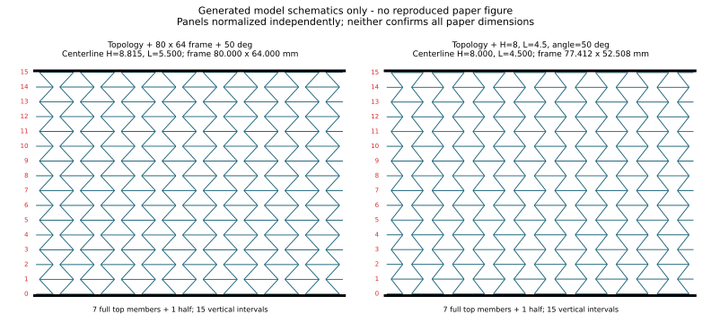

# Kiểm tra lại hình học theo ảnh người dùng cung cấp

**Bản TABLE trước đây không tái hiện đúng ảnh: số hàng và cách cắt biên khác. Đã dừng các phép nén dài của bản TABLE; không dùng chúng để kết luận validation đạt.**



## Những gì đã xác định và kiểm tra bằng tọa độ

- 16 mức thanh ngang, tức 15 khoảng đứng; 7,5 chu kỳ hourglass theo chiều cao.
- Mép trên: 7 thanh đầy đủ và nửa thanh ở mép phải.
- Mép dưới: nửa thanh ở mép trái và 7 thanh đầy đủ; lệch pha với mép trên.
- Hai cạnh bên hở, có các đoạn thanh ngang ngắn nhô ra xen kẽ. Không có khung đứng đóng hai cạnh bên.
- Thanh ngang ở eo nối sang ô bên cạnh, không nối xuyên khoảng rỗng của cùng một hourglass.
- Hai đường dài ngoài cùng trên/dưới là bàn ép, không phải thành specimen.
- Các mặt shell của mẫu liên thông ở nút chung, dày 0,8 mm, chiều sâu 30 mm.

Đã sửa một lỗi cắt biên số học: thanh nằm tại y=63.60000000000001 có thể bị loại nếu biên cắt là y=63.6. Bộ cắt mới có dung sai và snap về biên. `check_geometry.py` kiểm tra riêng trường hợp này cùng số hàng, số thanh đầy đủ/nửa thanh, pha biên và tính liên thông. Bản TABLE cũ không thay đổi sau bản vá này; nó vẫn sai topology so với ảnh.

## Hai cách dựng đối chiếu — chưa cách nào xác nhận đủ kích thước bài báo

| Trường hợp | Khung dựng X×Y (mm), sau khi xoay phương nén thành global Y | H đường giữa (mm) | L₁ đường giữa (mm) | Góc |
|---|---:|---:|---:|---:|
| Giữ H/L₁/góc bảng như kích thước đường giữa + topology ảnh | 77,412 × 52,508 | 8 | 4,5 | 50° |
| Giữ topology ảnh + khung 80×64 + góc 50° | 80 × 64 | 8,815406 | 5,500116 | 50° |

Cả hai có 16 mức/15 khoảng đứng, 7 thanh đầy đủ + nửa thanh ở mỗi mép, và cùng đồ thị liên kết. Các panel trong ảnh được chuẩn hóa độc lập để so **topology**, không chứng minh kích thước vật lý bằng nhau. Khung dựng có dự phòng nửa thickness tại mép, không khẳng định bề bao solid thực tăng đúng một thickness ở mọi đầu cắt.

Với giả định H/L₁ đo trên đường giữa:

`a=L₁ cosθ`, `b=L₁ sinθ`, `P=2(H−a)`.

Topology ảnh cho chiều cao đường giữa `15b` và bề ngang đường cắt `7,5P`. Chọn pha mép trái `x_left=a−H/2`, nên mép trên có thanh đầy đủ và mép dưới có nửa thanh.

Nếu H=8, L₁=4,5, θ=50°: `b=3,4472`, `P=10,214912`; cộng dự phòng t=0,8 cho khung thành 77,411836×52,508 mm.

Nếu giữ khung 80×64 và θ=50°: `b=(64−0,8)/15`, `P=(80−0,8)/7,5`; suy ra `a=b/tanθ`, `H=P/2+a=8,815406`, `L₁=b/sinθ=5,500116`.

**Đây là mâu thuẫn của cách hiểu đường giữa hiện tại với bộ ràng buộc, không đủ cơ sở kết luận bảng bài báo sai.** H và L₁ có thể được định nghĩa theo mặt/điểm đo khác; chưa xác nhận được quy tắc đó từ hai PDF. Không tự nhận H/L₁ suy ra là các giá trị 8/4,5 trong bảng. Không kéo dãn mesh rồi giữ nhãn kích thước cũ. Cần CAD hoặc bản vẽ tọa độ/kích thước đủ rõ để chốt trước khi validation định lượng.

Khối lượng shell cũng chưa khớp: bản khung 80×64 suy ra ở đây khoảng 55,089 g, bản giữ H/L₁ địa phương khoảng 47,34 g. Giá trị suy ra từ mật độ biểu kiến và kích thước danh nghĩa bài báo là 46,08 g. Chênh lệch có thể gồm hình học, định nghĩa kích thước và chồng thể tích tại giao shell; chưa được tách riêng. Gần khối lượng không đủ chứng minh mô hình đúng.

## Tạo lại input để kiểm tra hình học

Tải cả repository rồi chạy Python 3 tại thư mục này:

```text
python build_candidates.py
python check_geometry.py
```

Bộ sinh dùng `../opensource_pa12/geometry_core.py` và `build_radioss.py`. Tạo hai thư mục `image_local_candidate/` và `image_envelope_candidate/`, mỗi thư mục có `.rad`, `.inp`, `.vtk`, CSV đường giữa và metadata. Không tự chạy solver. Các input là **giả thuyết hình học để review**, đặt thử 2% strain ở 100 mm/s, chưa phải bản validation.

Để mở `.inp` trong Abaqus/CAE: **File → Import → Model**, chọn `reentrant_X.inp`; lưới được nhập dạng orphan mesh. Không gọi đây là CAD feature đã tái lập từ tác giả.

## Trạng thái chạy cloud

- Probe TABLE đến strain 2% tại 100 mm/s đã kết thúc bình thường; E fit 0–1% khoảng 12,724 MPa, cao hơn giá trị thí nghiệm Table 3 là 9,7 MPa khoảng 31,2%. Đây là kết quả của hình học TABLE bị loại, không phải validation của ảnh mới.
- Hai phép nén dài TABLE được **chủ động ngắt** khi người dùng yêu cầu kiểm tra lại ảnh: mesh 2 mm khoảng strain 0,2839, mesh 4 mm khoảng 0,4127. Engine báo CTRL-C/ERROR TERMINATION; không trình bày chúng như các đường nén hoàn chỉnh đến 50%.
- Không còn Engine chạy nền. Các log, restart và frame tính toán được giữ trong workspace để truy vết.
- Chưa chạy hai giả thuyết hình học mới để ép khớp đường cong; chưa chỉnh vật liệu hoặc ma sát để bù sai hình.

## Nguồn

Topology được đối chiếu trong chat với Fig.9 của Alomarah et al., DOI 10.1080/17452759.2019.1644184, là mẫu re-entrant-X được dùng lại trong Fig.4 của Chen et al., DOI 10.1016/j.tws.2026.114952. Hai PDF do người dùng cung cấp. Báo cáo này không thay cho CAD/data gốc của tác giả.
