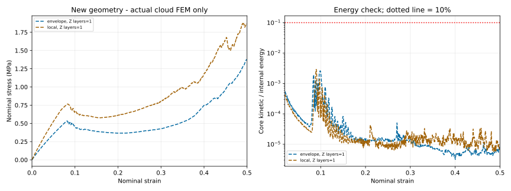
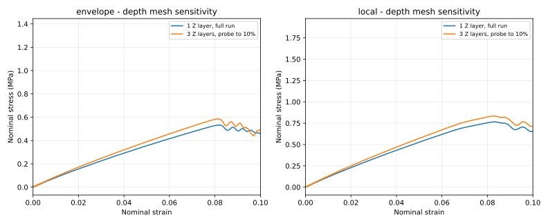

# Kết quả chạy CLOUD — geometry MỚI đã sửa topology

**Hai mô hình mới đã chạy hết hành trình đến nominal strain 0,5 tại 100 mm/s, Engine kết thúc bình thường. Kết quả này KHÔNG dùng geometry TABLE cũ.** Đã thực hiện đối chiếu định lượng với paper; chưa đủ cơ sở kết luận validation đạt đầy đủ.



## 1. Hai giả thuyết hình học được chạy riêng

| Tên trong file | Khung dựng ngang × cao × sâu (mm) | H đường giữa (mm) | L₁ đường giữa (mm) |
|---|---:|---:|---:|
| `envelope` | 80 × 64 × 30 | 8,815406 | 5,500116 |
| `local` | 77,411836 × 52,508 × 30 | 8 | 4,5 |

Cả hai đều có góc 50°, thành 0,8 mm, **16 mức thanh ngang/15 khoảng đứng**, 7 thanh đầy đủ và nửa thanh ở mỗi mép trên/dưới, lệch pha như ảnh người dùng gửi. Đường giữa có 353 đoạn; file audit lưu hash của input thật đã chạy. Không sử dụng mạng TABLE 437 đoạn của các lần thử trước.

`envelope` giữ khung danh nghĩa của bài và góc, nhưng chiều dài đường giữa suy ra khác H/L₁ trong bảng. `local` giữ H/L₁/góc như kích thước đường giữa, nhưng khung tổng thể khác bảng. Khung dựng có dự phòng thickness ở biên, không phải phép đo solid CAD. Quy ước H/L₁ của tác giả vẫn chưa được xác nhận đầy đủ; không gọi một trong hai giả thuyết là CAD gốc chính xác.

## 2. Thiết lập thực tế

- OpenCourant Linux x86-64 double precision, banner commit `cb760c206e346eff12161a2268b134ef9d48a4ef`; SMP 1 thread mỗi job. Windows runner được chuẩn bị nhưng chưa kiểm chứng thực tế trên Windows.
- PA12: E=1300 MPa, ν=0,33, density=1e-9 tonne/mm³. Bảng hardening trung bình Table 2, chưa phải đường Test-1 gốc. Không chỉnh vật liệu/ma sát theo đường thực nghiệm.
- Bàn dưới rigid body khóa 6 DOF. Bàn trên rigid body chỉ chuyển động theo global -Y, **100 mm/s** theo FEA của Alomarah. Không dùng 1000 mm/s của ảnh mô hình nhôm cho lần đối chiếu này.
- QEPH, 5 điểm tích phân qua dày thành; general geometric nonlinearity; TYPE7 contact, μ=0,25. Không damage, không mass scaling, không thêm imperfection.
- Mesh theo chiều dài thành danh nghĩa **2 mm**. Hai đường nén đầy đủ dùng **1 lớp phần tử theo chiều sâu Z=30 mm**: 1283 shell cho `envelope`, 1155 cho `local`.
- Đây là rút gọn lưới theo Z, **không phải giảm chiều sâu vật lý xuống 1 mm**, và không phải giảm số điểm tích phân qua thành dày 0,8 mm. Độ sâu vẫn 30 mm, vật liệu/thể tích/khối lượng giữ nguyên. Chưa thay thế mô hình S4R mesh 1 mm đầy đủ của tác giả.

## 3. Đối chiếu định lượng

Các số dưới đây thuộc **hai đường nén đầy đủ 1 lớp Z, mesh 2 mm**; không trộn với các probe lưới khác.

| Đại lượng | Paper tham chiếu | `envelope` mới | `local` mới |
|---|---:|---:|---:|
| E danh nghĩa (MPa) | 9,7 — Table 3, experimental re-entrant-X | 8,180 | 11,906 |
| Sai lệch E | — | −15,7% | +22,7% |
| σ tại ε=0,20 (MPa) | ≈0,639 — số hóa Fig.9 Specimen-1 | 0,366 | 0,612 |
| RMSE so Fig.9 Specimen-1, ε=0,06–0,40 (MPa) | — | 0,373 | 0,090 |
| RMSE/ứng suất tham chiếu trung bình, cùng cửa sổ | — | 47,3% | 11,4% |
| RMSE so Experiment [59] trong Fig.4 Chen, ε=0,06–0,40 (MPa) | — | 0,305 | 0,076 |
| RMSE so Fig.4 Chen, cửa sổ mở rộng ε=0,06–0,49 (MPa) | — | 0,479 | 0,174 |

Ở ε=0,49, `local` dự đoán khoảng 1,877 MPa, đường Experiment [59] trong Fig.4 Chen số hóa khoảng 2,511 MPa: thấp hơn khoảng 25,3%. Vì vậy phần giữa đường cong khớp hơn không có nghĩa toàn bộ giai đoạn densification khớp.

E của `envelope` gần FEA gốc trong Table 3 (8 MPa), nhưng ứng suất phần giữa thấp rõ rệt. `local` gần đường thực nghiệm Fig.9 ở vùng giữa hơn, nhưng E cao, ứng suất vùng strain lớn thấp, và khung tổng thể khác bảng. Chưa chọn/chỉnh hình học chỉ để tối thiểu hóa RMSE.

### Cách tính và nguồn tham chiếu

- E: fit OLS có intercept trong ε=0–0,01. Đây là quy trình ước lượng slope của kết quả tính, không giả định tái hiện thuật toán của máy thử.
- σ = lực contact nén có dấu / (bề ngang của chính mô hình × 30 mm); ε = hành trình RP trên / chiều cao của chính mô hình. `local` dùng 77,411836 và 52,508, không lấy mẫu kích thước khác rồi mặc nhiên chuẩn hóa như 80×64.
- Lực lấy bằng đạo hàm theo thời gian của **xung lượng TH tích lũy** trong release đã chạy. Không lấy absolute value để che mất tiếp xúc. CSV giữ lực contact trên/dưới, drive reaction và năng lượng riêng.
- Đường tham chiếu được số hóa từ hai PDF người dùng cung cấp, không phải raw experimental data của tác giả. Trong Fig.9, phần đường đầu bị đường khác che nên chỉ dùng cửa sổ số hóa tin cậy từ khoảng 0,057 đến 0,430. RMSE chính lấy vùng 0,06–0,40; Fig.4 Chen có thêm cửa sổ đến 0,49 để không bỏ qua sai lệch cuối đường.
- Sai số đọc ảnh ước lượng từ pixel: Fig.9 khoảng ±0,00155 strain và ±0,0115 MPa; Fig.4 khoảng ±0,00226 strain và ±0,0140 MPa. Đây không phải confidence interval của thí nghiệm và chưa bao gồm mọi sai số xử lý ảnh.
- Nội suy tuyến tính lên strain grid chung; không smoothing, không hiệu chỉnh đường cong để giảm lỗi. Hai đường experimental được vẽ trong hai bài không hoàn toàn trùng nhau và không được coi là hai thí nghiệm độc lập.
- Đồ thị overlay với đường paper đã được hiển thị trong cuộc trò chuyện. Gói công khai này chỉ chứa dữ liệu/đồ thị FEM tự tính và các chỉ số tổng hợp; không chứa hình trích PDF hay bảng điểm đường tham chiếu số hóa.

## 4. Kiểm tra số học — chưa đủ để tuyên bố hội tụ/validation đạt

- Hai full run: Starter 0 errors, không warning 343; Engine normal termination. History cuối khoảng ε=0,49950 vì thời gian ghi TH có thể trước điểm cuối tối đa một output interval; Engine đã kết thúc ở thời gian mục tiêu.
- Max core KE/IE trong ε=0,06–0,40 khoảng **0,00261** (`envelope`) và **0,00290** (`local`), tức dưới 0,3%. Điều này cho thấy quán tính nhỏ trong cửa sổ đó, không tự chứng minh mọi sai số số học nhỏ.
- Lỗi năng lượng Engine báo cuối: khoảng **−6,1%** và **−10,7%**. Cần cải thiện/giải thích trước khi dùng cho kết luận nghiên cứu.
- Thử **3 lớp Z** trên cùng geometry, vật liệu, chiều sâu thật và mesh 2 mm đến ε=0,1: E tăng từ 8,180 lên 8,946 MPa (`envelope`, +9,37%); từ 11,906 lên 12,971 MPa (`local`, +8,95%). Sai khác RMS đường ứng suất trong ε=0,02–0,099 khoảng 8,8% và 8,4%. Chưa chứng minh hội tụ của toàn đường nén đến 50%.
- Thử `local` với mesh theo thành **1 mm, 3 lớp Z**, đến ε=0,02: E≈12,171 MPa, vẫn cao hơn 9,7 MPa khoảng 25,5%. Starter có warning 343 về initial penetrations tại giao shell; đã ghi và giữ cảnh báo, không coi đây là mesh convergence đã đạt.
- TYPE7 có điều chỉnh gap và cap theo kích thước mesh, không đồng nhất với Abaqus general contact; edge-to-edge contact chưa tương đương. Các probe 1 mm cho thấy cần xử lý contact/mesh ở giao thành tốt hơn.



**Kết luận:** đã chạy và đối chiếu được geometry mới. `local` phù hợp vùng giữa đường cong hơn, nhưng **chưa đủ cơ sở kết luận validation đạt đầy đủ** do quy ước kích thước chưa chốt, ảnh hưởng lưới Z/mesh/contact, sai số E và sai lệch năng lượng. Không hiệu chỉnh E/yield/density để bù sai hình học. Bước cần thiết tiếp theo là xác nhận CAD/quy ước H/L₁, giải quyết contact ở giao thành và chứng minh hội tụ ở mesh 1 mm/chiều sâu, rồi dùng đúng Test-1 nếu có dữ liệu gốc.

## 5. Tải và tự kiểm tra

Tải `cloud_results.zip`, giải nén. Trong gói có:

- `results/envelope_nz1_full/`, `results/local_nz1_full/`: `.rad` Starter/Engine thật đã chạy, `compression_curve.csv`, metadata, summary, log.
- `results/*_nz3_probe/`, `results/local_nz3_mesh1_probe/`: các phép kiểm tra lưới, được ghi đúng strain mục tiêu 0,1 hoặc 0,02; không gọi chúng là full 50%.
- `assessment/metrics.json`, `inplane_mesh_probe.json`, `geometry_and_reproduction_audit.json`: chỉ số và hash input; input của cả 5 phép thử tái tạo byte-identically bằng script bàn giao.
- Hai hình biến dạng tự tính tại hành trình 0/4/8/12 mm. Với `local`, 12 mm tương ứng strain≈0,2285 vì chiều cao của mô hình khác 64 mm; không đổi nhãn để làm giống paper.
- `code/`, `configs/`, `run_cases.py`: toàn bộ mã tái tạo; không có solver binaries hoặc PDF tham chiếu.

Để chỉ tạo input:

```text
python run_cases.py --out runs_new
```

Để chạy lại bằng OpenCourant đã cài:

```text
python -m pip install -r requirements.txt
python run_cases.py --out runs_new --run --root /path/to/OpenCourant --threads 1
```

Windows có `run_new_geometry_windows.bat`; đặt `OPENCOURANT_ROOT` đến thư mục giải nén trực tiếp chứa `exec`, `extlib`, `hm_cfg_files`. Tên folder output phải mới khi chạy lại để tránh trộn history cũ. Các lần kiểm chứng thực tế ở đây là Linux.

## Tài liệu

- Alomarah et al., *Compressive properties of 3D printed auxetic structures: experimental and numerical studies*, DOI [10.1080/17452759.2019.1644184](https://doi.org/10.1080/17452759.2019.1644184), Fig.9 và Tables 1–4.
- Chen et al., *Machine learning for performance prediction and multi-objective optimization of a novel auxetic structure*, DOI [10.1016/j.tws.2026.114952](https://doi.org/10.1016/j.tws.2026.114952), Fig.4.
- [OpenCourant](https://github.com/OpenCourant/OpenCourant), bản tiếp nối mã nguồn mở OpenRadioss; tải solver từ releases chính thức, giữ giấy phép đi kèm.
