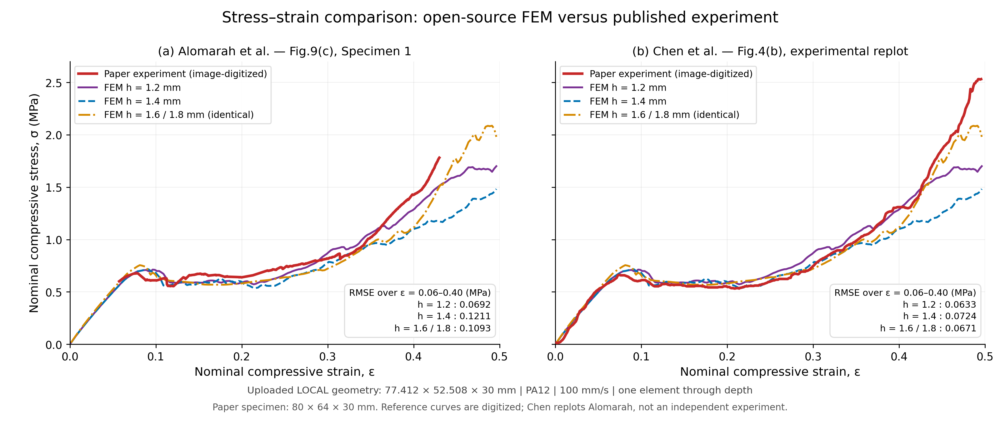

# Stress–strain comparison with the papers



[PDF](stress_strain_vs_papers.pdf) · [SVG](stress_strain_vs_papers.svg) · [Plotting code](plot_validation.py)

The red lines are image-digitized experimental reference curves, not raw experimental CSVs. Left: Alomarah et al., DOI 10.1080/17452759.2019.1644184, Fig.9(c), Specimen 1. Right: Chen et al., DOI 10.1016/j.tws.2026.114952, Fig.4(b), an experimental replot attributed to Alomarah. These are not independent experiments.

The FEM curves are the completed OpenCourant cloud runs for the uploaded corrected LOCAL geometry. Nominal mesh sizes 1.6 and 1.8 mm generate identical actual meshes and identical computed curves, so they share one plotted line. RMSE is evaluated over nominal strain 0.06–0.40 with linear interpolation, without extrapolating missing reference data.

The LOCAL specimen is 77.412 × 52.508 × 30 mm, versus the paper specimen 80 × 64 × 30 mm. The cloud models retain one element through depth. Mesh convergence and full quantitative validation have not been established; energy errors and late-stage crushing discrepancies remain documented in the [main assessment](../README.md).

To regenerate, install NumPy and Matplotlib and supply the reference CSV folder separately:

```bash
python plot_validation.py --data-root .. --references /path/to/reference_csv_folder
```

Required reference files: `reference_Fig9_specimen1_digitized.csv` and `reference_Chen_Fig4_experimental_digitized.csv`. They are not bundled here. No original paper PDF or cropped paper figure is included.
